<!-- ========================= BANNER ========================= -->

  <a href="https://github.com/KauaMatsuo"></a>

  

  
  
  
  

 

<!-- ========================= SOBRE MIM ========================= -->
<a href="https://www.linkedin.com/in/kau%C3%A3-kenzo-matsuo"></a>

<!-- ========================= FICHA ========================= -->
<a href="https://www.linkedin.com/in/kau%C3%A3-kenzo-matsuo">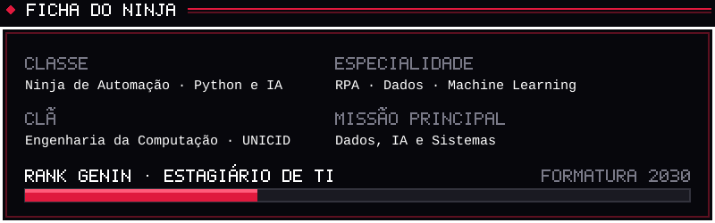</a>

<!-- ========================= MAPA ========================= -->
<a href="https://github.com/KauaMatsuo"></a>

<!-- ========================= ATRIBUTOS ========================= -->
<a href="https://github.com/KauaMatsuo">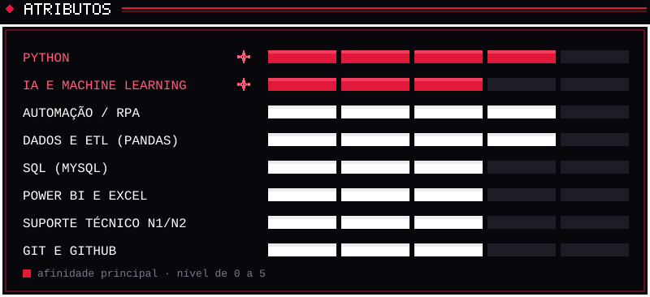</a>

<!-- ========================= CONQUISTAS ========================= -->
<a href="https://github.com/KauaMatsuo/Automatsuo">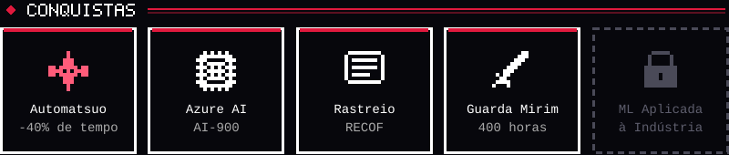</a>

<!-- ========================= INVENTÁRIO ========================= -->
<a href="https://github.com/KauaMatsuo">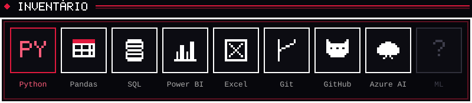</a>

<!-- ========================= MISSÕES ========================= -->
<a href="https://github.com/KauaMatsuo/Automatsuo">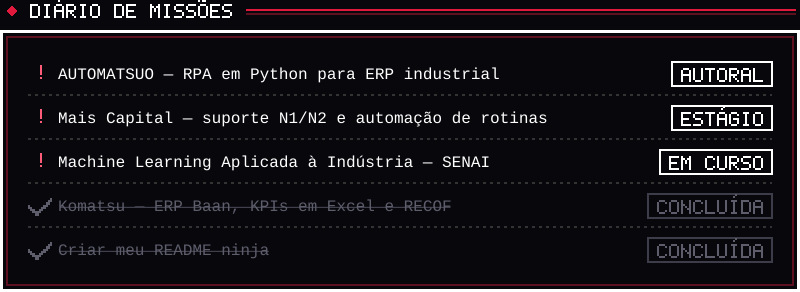</a>

<!-- ========================= REGISTRO NINJA ========================= -->
<a href="https://github.com/KauaMatsuo?tab=repositories">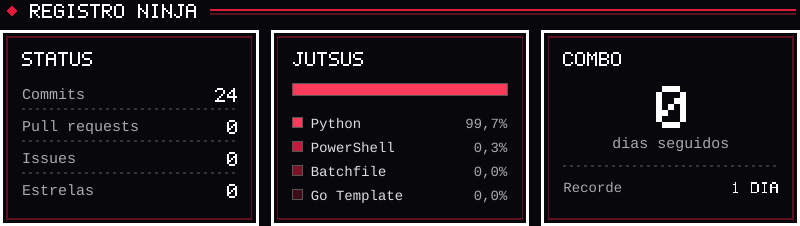</a>

<!-- ========================= MINIGAME ========================= -->
<a href="https://github.com/KauaMatsuo?tab=repositories"></a>

 

<!-- ========================= CONTINUE ========================= -->

  

  
  

 

<!-- ========================= RODAPÉ ========================= -->
<a href="https://github.com/KauaMatsuo"></a>
